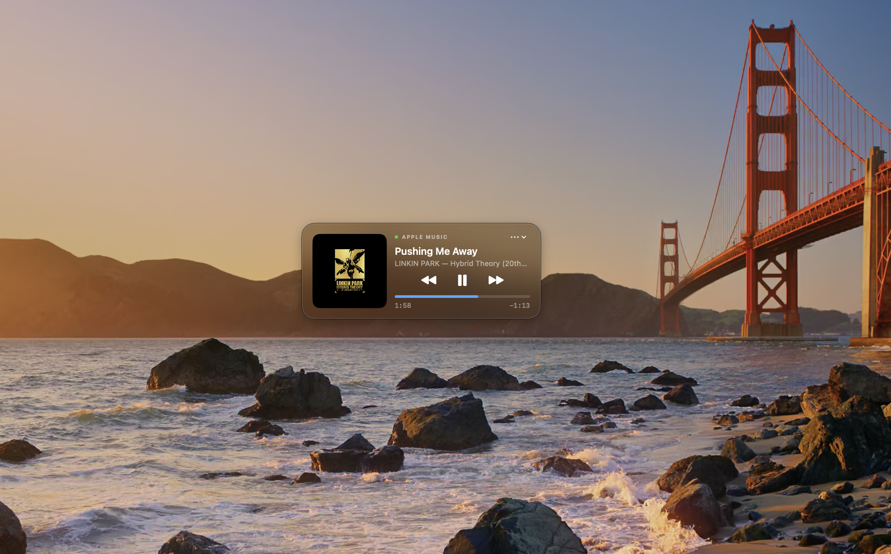
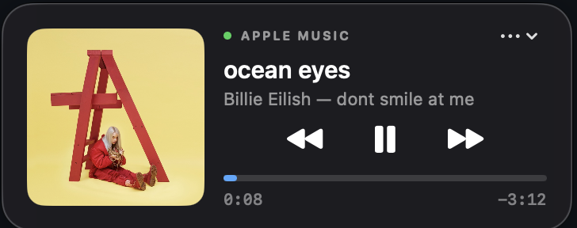

<p align="center"></p>

# Floating Music

A compact, native floating music player for macOS. Keep Apple Music or Spotify controls above your other windows, in a draggable 360 × 144 widget.

[Download the latest release](https://github.com/cristianoalves92/floating-music/releases/latest) · [Português](docs/README.pt.md)

<p align="center"></p>

<details>
<summary>Close-up of the playback controls</summary>

<p align="center"></p>

</details>

## Features

- Album artwork, track title, artist, album and playback progress.
- Previous, play/pause and next controls; click the progress bar to seek.
- Click the source name to open Apple Music or Spotify.
- Drag the artwork or track title to move the widget. Its position is saved.
- Automatic source selection, preferring an app that is playing. Apple Music takes priority if both are playing.
- Hide the widget with × and reopen it from the menu bar.
- Portuguese, English, Spanish, French, German and Italian. Choose a language under (…) → Language, or follow your system language.

## Install

1. Download `Floating-Music-v1.0.1-universal.zip` from [Releases](https://github.com/cristianoalves92/floating-music/releases).
2. Extract it and move **Floating Music.app** to **Applications**.
3. Open the app. This release is **ad-hoc signed, not Developer ID signed or notarized**. macOS may block its first launch. If you trust the download, follow [Apple’s instructions](https://support.apple.com/en-us/102445): attempt to open it, then go to **System Settings → Privacy & Security → Open Anyway** if that option is offered. Managed Macs may restrict this.
4. Allow Floating Music to control Music or Spotify when macOS requests Automation access.
5. Start playback in your music app.

Requires **macOS 13 or later**. The release contains both Apple Silicon (arm64) and Intel (x86_64) binaries. Runtime verification has been performed on the developer’s Apple Silicon Mac only; Intel and older macOS releases have not yet been tested.

## Build from source

Requires Xcode with the macOS SDK and Swift compiler selected via `xcode-select`.

```sh
git clone https://github.com/cristianoalves92/floating-music.git
cd floating-music
./scripts/build.sh
open 'build/Floating Music.app'
```

The build script creates a universal app targeting macOS 13 and applies an ad-hoc signature. No API keys, package dependencies or developer account are required to build.

To package a release locally:

```sh
./scripts/package-release.sh
```

## Privacy and implementation

SwiftUI renders the widget; AppKit supplies the floating window and menu bar item. Apple Events read playback information and control the installed Music and Spotify apps. Status is polled once per second. The app downloads Spotify artwork from the HTTPS URL provided by Spotify. It has no analytics, account system or backend.

Language resources live in `Resources/<language>.lproj`. In-app language changes apply immediately and persist across launches; macOS permission prompts follow the system’s language selection. Song metadata is never translated.

## Current limitations

- Only Apple Music and Spotify are supported; browser audio and other apps are not integrated.
- Some streams may not provide artwork or duration.
- Full-screen behavior depends on the active app and macOS window management.
- This first release has limited device coverage. Spotify integration needs broader real-world testing.
- No auto-update mechanism is included.

The app icon was generated with ImageGen; the prompt is documented in `Assets/README.md`.

## License

[MIT License](LICENSE) — Copyright (c) 2026 Cristiano Alves.
